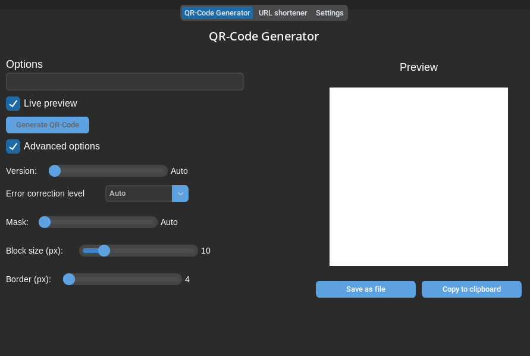
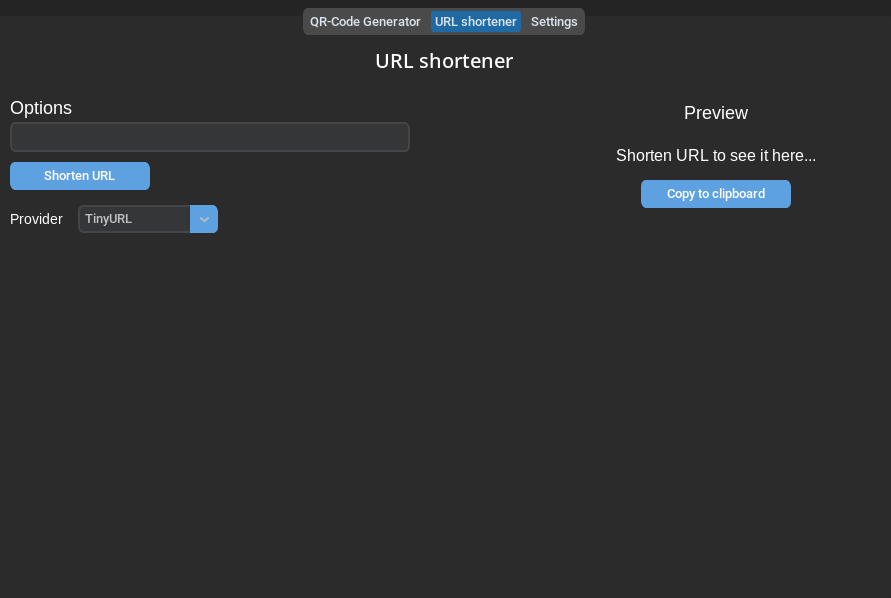
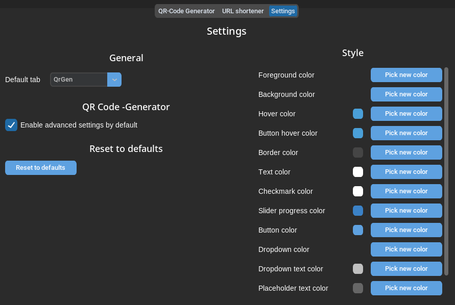
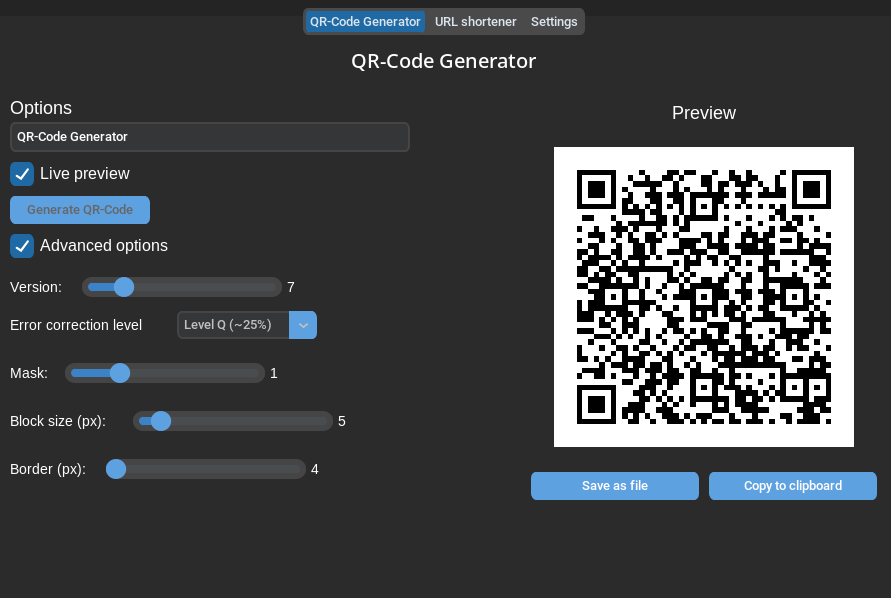

# QRL
With QRL you can generate qr-codes with specified settings or shorten URLs with specified provider. QRL is built with only python and it is cross-platform. You can either download pre-built binaries or build them yourself from source ([How to build and run](#how-to-build-and-run)). 

# Some pictures of QRL
<div>
  
  
  
  
</div>

# How to build and run
Run platform specific build commands below and run the generated executable. The generated executable needs `assets/` with the files inside in same folder in order to work correctly. 

# Build dependencies
| Dependency | Purpose |
|------------|---------|
| nuitka | For building |
| qrcode | For generating the QR code |
| customtkinter | For UI |
| CTkColorPicker | For color picking |
| Pillow | For image handling |
| requests | For URL shortening |
| pyperclip | For clipboard access |
| validators | For validating URL |
| cryptography | For data encryption |

Install build dependencies with:
```bash
python -m pip install qrcode customtkinter Pillow nuitka requests pyperclip validators cryptography
```
or 
```bash
pip install qrcode customtkinter Pillow nuitka requests pyperclip validators cryptography
```

# Platform specific build commands
## Linux
```bash
python -m nuitka --onefile --output-filename=QRL --linux-icon=assets/python_sucks.png --lto=yes --remove-output --enable-plugin=tk-inter --include-package-data=customtkinter --include-package-data=CTkColorPicker main.py
```

## Windows
### Window dependencies
| Dependency | Purpose |
|------------|---------|
| pywin32 | For win32clipboard and win32con |

Install with 
```ps1
python.exe -m pip install pywin32
```

### Build command
```ps1
python.exe -m nuitka --onefile --output-filename=QRL.exe --windows-icon-from-ico=assets/python_sucks.ico --windows-console-mode=disable --tcl-library-dir="C:\Users\YOUR_USER\AppData\Local\Programs\Python\Python314\tcl" --tk-library-dir="C:\Users\YOUR_USER\AppData\Local\Programs\Python\Python314\tcl" --lto=yes --remove-output --enable-plugin=tk-inter --include-package-data=customtkinter --include-package-data=CTkColorPicker main.py
```

Change `YOUR_USER` to your actual username in `--tk-library-dir=""`
Use `Python 3.14` for building

## MacOS
### Disclaimer
MacOS builds are added if I can get/build them, otherwise build the app yourself

### MacOS dependencies
| Dependency | Purpose |
|------------|---------|
| pyobjc-framework-AppKit | For MacOS only clipboard |
| pyobjc-framework-Foundation | For MacOS only data types |

Install with
```bash
python -m pip install pyobjc-framework-AppKit pyobjc-framework-Foundation
```

### Build command
```bash
python -m nuitka --output-filename=QRL --mode=app --macos-app-icon=assets/python_sucks.icns --lto=yes --remove-output --enable-plugin=tk-inter --include-package-data=customtkinter --include-package-data=CTkColorPicker main.py
```

# License
Licensed under MIT

# AI Usage
AI was used to help with research, syntax and platform specific code. This is not fully vibe-coded AI slop app.

# Changelog
## v1.1.0
- Added Settings tab with customizable colors for the whole UI
- Added encrypted local settings storage (`QRL.data`)
- Added option to choose the default startup tab
- Added option to enable advanced QR settings by default
- Refactored widget creation into a shared Helpers module
- Settings changes now rebuild the UI after 1s without restarting
- Updated build commands to bundle package data for customtkinter and CTkColorPicker
- Changed Qr code generation debounce timer to tkintern's built-in timer from Threading

## v1.0.1
- Fixed MacOS clipboard issues
- Fixed MacOS build command
- Added MacOS build

## v1.0
- Initial release